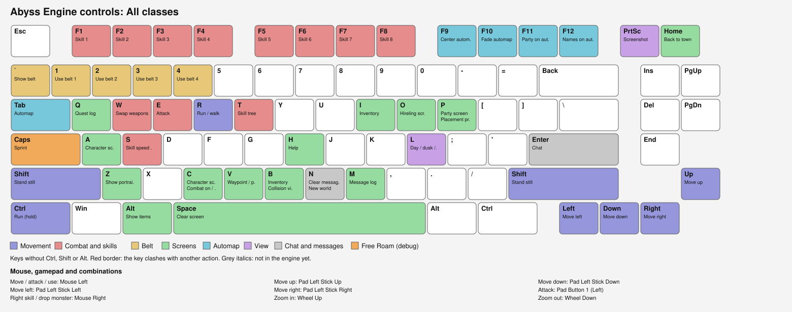
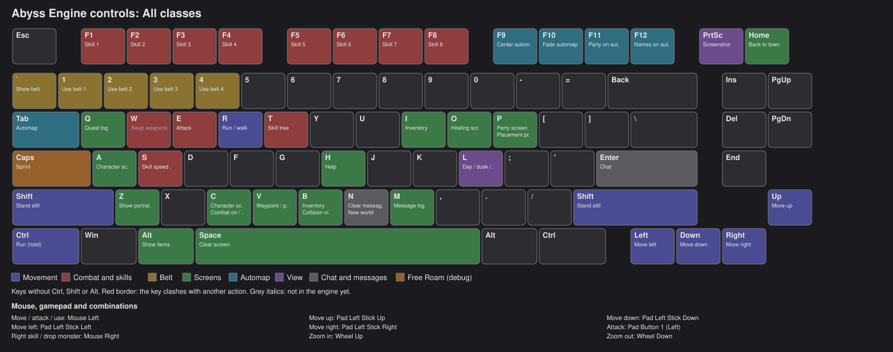
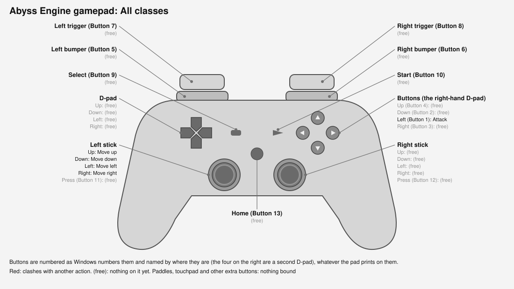
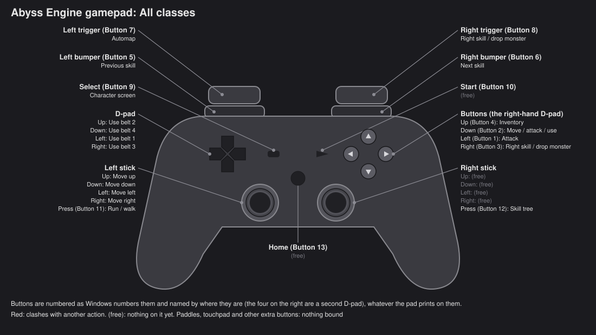

# Controls

The default controls, for all classes. They can all be changed in **Options › Controls** ([Options](Options.md));
**Export** there writes this same page (`controls.md`) with the keyboard and gamepad pictures (light and dark) for your
own bindings, next to `abyss.ini`.

**Esc** isn't bindable: it closes what's open, or opens the game menu (Options, leave, back to the game).

Show Keyboard Layout (Light Theme)

Show Keyboard Layout (Dark Theme)

Show Gamepad Layout (Light Theme)

Show Gamepad Layout (Dark Theme)

## Movement

| Action | Mouse | Keyboard | Controller | Note |
|---|---|---|---|---|
| Move / attack / use | `Mouse Left` | - | `Pad Button 2 (Down)` |  |
| Move up | - | `Up` | `Pad Left Stick Up` |  |
| Move down | - | `Down` | `Pad Left Stick Down` |  |
| Move left | - | `Left` | `Pad Left Stick Left` |  |
| Move right | - | `Right` | `Pad Left Stick Right` |  |
| Run / walk | - | `R` | `Pad Button 11 (Left Stick Press)` |  |
| Run (hold) | - | `Left Ctrl` | - |  |
| Stand still | - | `Left Shift`, `Right Shift` | - |  |

## Combat and skills

| Action | Mouse | Keyboard | Controller | Note |
|---|---|---|---|---|
| Attack | - | `E` | `Pad Button 1 (Left)` |  |
| Right skill / drop monster | `Mouse Right` | - | `Pad Button 3 (Right)`, `Pad Button 8 (Right Trigger)` |  |
| Swap weapons | - | `W` | - |  |
| Skill 1 | - | `F1` | - |  |
| Skill 2 | - | `F2` | - |  |
| Skill 3 | - | `F3` | - |  |
| Skill 4 | - | `F4` | - |  |
| Skill 5 | - | `F5` | - |  |
| Skill 6 | - | `F6` | - |  |
| Skill 7 | - | `F7` | - |  |
| Skill 8 | - | `F8` | - |  |
| Previous skill | - | - | `Pad Button 5 (Left Bumper)` |  |
| Next skill | - | - | `Pad Button 6 (Right Bumper)` |  |
| Skill tree | - | `T` | `Pad Button 12 (Right Stick Press)` |  |
| Skill speed bar | - | `S` | - |  |

## Belt

| Action | Mouse | Keyboard | Controller | Note |
|---|---|---|---|---|
| Use belt 1 | - | `1` | `Pad D-pad Left` |  |
| Use belt 2 | - | `2` | `Pad D-pad Up` |  |
| Use belt 3 | - | `3` | `Pad D-pad Right` |  |
| Use belt 4 | - | `4` | `Pad D-pad Down` |  |
| Show belt | - | `` ` `` | - |  |

## Screens

| Action | Mouse | Keyboard | Controller | Note |
|---|---|---|---|---|
| Character screen | - | `A`, `C` | `Pad Button 9 (Select)` | `C` also on an action that's never active at the same time |
| Inventory | - | `B`, `I` | `Pad Button 4 (Up)` | `B` also on an action that's never active at the same time |
| Party screen | - | `P` | - | `P` also on an action that's never active at the same time |
| Hireling screen | - | `O` | - |  |
| Quest log | - | `Q` | - |  |
| Message log | - | `M` | - |  |
| Help | - | `H` | - |  |
| Clear screen | - | `Space` | - |  |
| Show items | - | `Left Alt` | - |  |
| Show portraits | - | `Z` | - |  |
| Waypoint / places | - | `V` | - |  |
| Back to town | - | `Home` | - |  |

## Automap

| Action | Mouse | Keyboard | Controller | Note |
|---|---|---|---|---|
| Automap | - | `Tab` | `Pad Button 7 (Left Trigger)` |  |
| Center automap | - | `F9` | - |  |
| Fade automap | - | `F10` | - |  |
| Party on automap | - | `F11` | - |  |
| Names on automap | - | `F12` | - |  |

## View

| Action | Mouse | Keyboard | Controller | Note |
|---|---|---|---|---|
| Zoom in | `Wheel Up` | - | - |  |
| Zoom out | `Wheel Down` | - | - |  |
| Day / dusk / night | - | `L` | - |  |
| Screenshot | - | `PrintScreen` | - |  |

## Chat and messages

| Action | Mouse | Keyboard | Controller | Note |
|---|---|---|---|---|
| Chat | - | `Return` | - |  |
| Clear messages | - | `N` | - | `N` also on an action that's never active at the same time |

## Free Roam (debug)

| Action | Mouse | Keyboard | Controller | Note |
|---|---|---|---|---|
| Combat on / off | - | `C` | - | `C` also on an action that's never active at the same time |
| Collision view | - | `B` | - | `B` also on an action that's never active at the same time |
| Placement preview | - | `P` | - | `P` also on an action that's never active at the same time |
| New world | - | `N` | - | `N` also on an action that's never active at the same time |
| Sprint | - | `CapsLock` | - |  |

